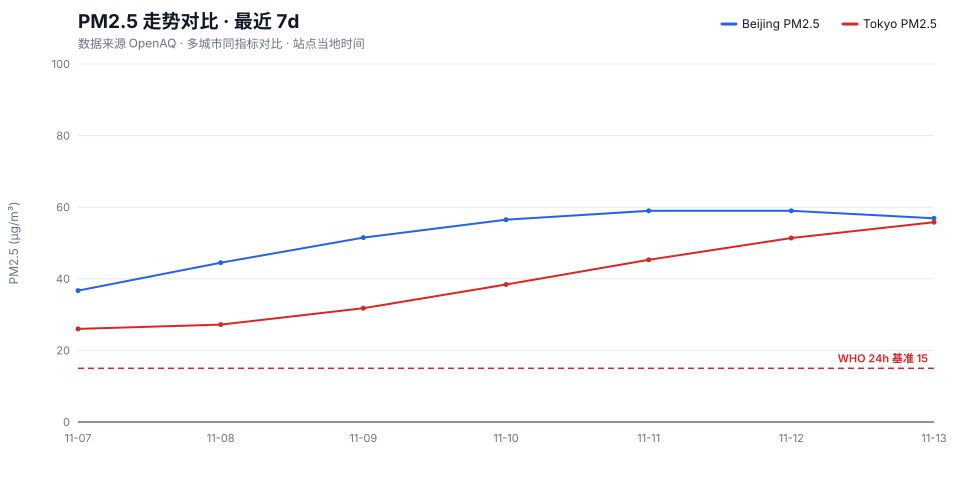
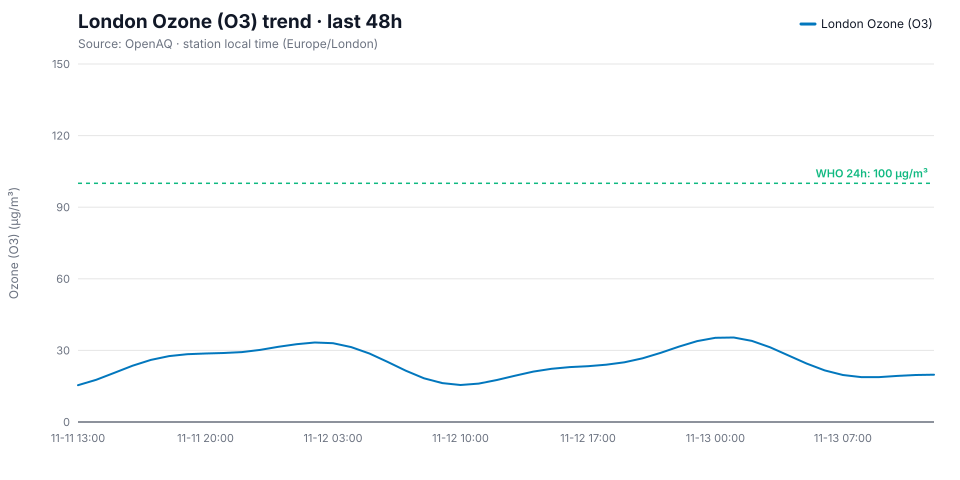
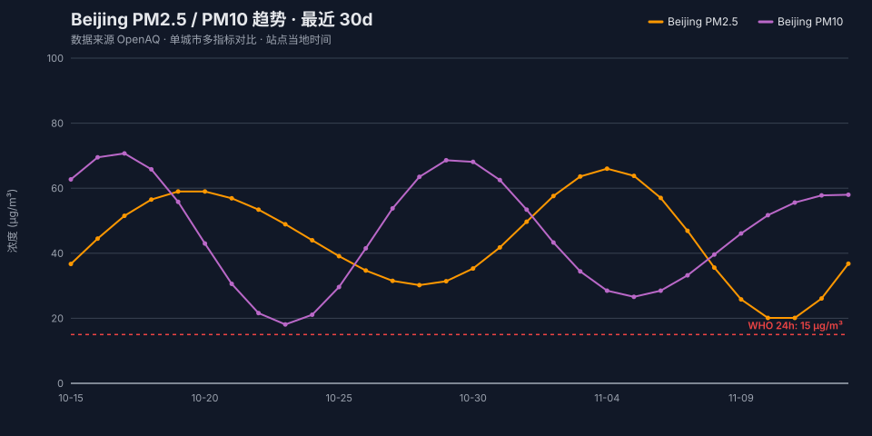

<div align="center">

# Air-chart

**Natural-language air quality queries → global monitoring-station matching → zero-dependency high-resolution SVG charts.**
**Powered by the [OpenAQ](https://openaq.org) API v3 (reference-grade government monitoring data from 100+ countries).**

English | [简体中文](README.zh.md)


[](LICENSE)

</div>

`air-chart` is an agent skill that turns a plain-language request — "compare PM2.5
in Tokyo vs Seoul over the past week" — into a rendered SVG chart. It resolves the
city, picks the best *active* monitoring station, cleans the time series, and draws
the chart. No Python, no Matplotlib, no Node runtime: just `bash`, `jq`, `awk` and
`curl`, with a hand-rolled awk SVG renderer.

## Showcase

| Multi-city comparison (7-day PM2.5) | Single-city 48h ozone |
| --- | --- |
|  |  |

| Multi-station snapshot | Multi-parameter (dark theme) |
| --- | --- |
|  |  |

## Features

- **Zero heavy dependencies** — pure `bash` / `jq` / `awk` / `curl`; the SVG renderer is written in awk.
- **Global coverage** — built-in coordinates for 200+ major cities worldwide, or pass `lat,lon` directly.
- **Smart station selection** — 25 km radius search → drop "zombie" stations silent for 24h (72h fallback) → prefer government reference-grade monitors.
- **Professional visuals** — physical concentration units (µg/m³) prominently labeled, WHO 24-hour guideline line overlaid by default (green when compliant, red when exceeded), light/dark themes.
- **Engineered for real use** — local cache (20 min for hourly / 2 h for daily data), exponential backoff on HTTP 429, gap-aware rendering (missing slots break the line — never filled with 0), UTC → station-local-time alignment.

## Quick start

### 1. Get an API key (free)

Register at [OpenAQ](https://explore.openaq.org/register), then pick one:

```bash
export OPENAQ_API_KEY="your_key"                             # ephemeral / CI
echo 'OPENAQ_API_KEY=your_key' > ~/.config/air-chart/config  # persistent
```

No system keychain required — a free, public-service credential stays in a plain
config file. Without a key, `--demo` mode still renders everything with sample data.

### 2. Run

```bash
# Single city, 7-day PM2.5 trend
./scripts/air_chart.sh --city Beijing --param pm25 --period 7d

# Multi-city comparison (up to 4 cities)
./scripts/air_chart.sh --city Tokyo --city Seoul --param pm25 --period 7d

# Multi-parameter single city (PM2.5 + PM10)
./scripts/air_chart.sh --city Beijing --param pm25 --param pm10 --period 30d

# 48-hour hourly curve (day/night pattern)
./scripts/air_chart.sh --city Singapore --param o3 --period 48h

# Multi-station real-time snapshot (bar chart)
./scripts/air_chart.sh --city Delhi --param pm10 --snapshot

# Dark theme, custom output
./scripts/air_chart.sh --city London --param no2 --period 14d --theme dark -o london.svg
```

### 3. Install as an AI agent skill

```bash
git clone https://github.com/qiakai/air-chart.git ~/.claude/skills/air-chart
# or: npx skills add qiakai/air-chart
```

Then just ask your agent: *"Compare PM2.5 in Tokyo and Seoul over the past 7 days."*

## CLI reference

| Flag | Description | Values |
| --- | --- | --- |
| `--city, -c` | City name (repeatable, ≤4) or coordinates `"lat,lon"` | `Beijing`, `New Delhi`, `39.9,116.4` |
| `--param, -p` | Pollutant (default `pm25`) | `pm25` `pm10` `o3` `no2` `so2` `co` |
| `--period, -t` | Time range (default `7d`) | `24h` `48h` (hourly) · `7d` `14d` `30d` (daily) |
| `--snapshot` | Multi-station real-time snapshot bar chart | flag |
| `--theme` | Color theme | `light` / `dark` |
| `--out, -o` | Output SVG path | default `./air-chart-<timestamp>.svg` |
| `--demo` | Demo mode, no API key needed | flag |

## Architecture

```text
[city / pollutant / time range]
   │
   ▼
geo_resolve.sh      city name → coordinates + timezone (built-in gazetteer / raw lat,lon)
   │
   ▼
openaq_client.sh    OpenAQ API v3: auth, User-Agent, md5 cache,
                    429 exponential backoff, liveness filter (24h/72h),
                    sensor match by fixed parameter ID, reference-grade first
   │
   ▼
data_transform.awk  cleaning (negatives / physically impossible spikes),
                    gap detection (breaks, never zero-filled), stats, local-time labels
   │
   ▼
render_draw.sh      pure-awk SVG renderer (lines / bars + WHO guideline + legend)
```

`data/parameters.tsv` is a static parameter dictionary aligned with the openaq-api
fixed pollutant IDs: slug / param_id / name / unit / WHO 24h guideline / physical
cap / per-parameter color — no redundant `/parameters` round-trips. Visuals follow
openaq-explorer conventions: per-parameter palette (PM2.5 `#E65100`, PM10 `#6A1B9A`,
O3 `#0277BD`, NO2 `#00838F`), a colorblind-friendly multi-city palette, and a WHO
guideline line in safety green `#10B981` / alert red `#EF4444`. If a station reports
units that differ from the dictionary default (e.g. ppm), the Y-axis uses the actual
units and the WHO line is suppressed to avoid dimensional confusion.

## Exit codes

| Code | Meaning |
| --- | --- |
| 3 | No API key configured (prints setup guidance) |
| 4 | Network / API error / rate-limit retries exhausted |
| 5 | No active station or no valid data |
| 2 | City name unresolvable (prints close candidates) |

## Further reading

- [技术解析文章（中文）](docs/article-zh.md)：零依赖 CLI 数据管道 + Agent Skill 视觉交付的架构实践

## License

MIT
